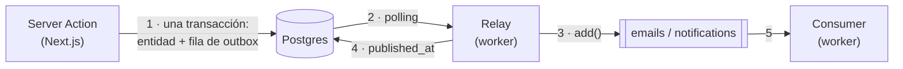

# Colas (BullMQ + Redis)

Cómo está cableado el trabajo asíncrono y cómo agregar un job nuevo. Los criterios generales
(garantías, reintentos, idempotencia) están en `greenaway/.claude/rules/05-async.md`.

## Panorama

- La **app** nunca toca Redis en el path de escritura: escribe la entidad y su fila de `outbox` en la
  misma transacción. Si Redis está caído, la reserva igual queda con su efecto pendiente.
- El **relay** (`src/relay.ts`) lee las filas sin publicar, las traduce a jobs
  (`src/outbox/fan-out.ts`), las encola y recién después marca `published_at`. No espera al consumer.
- El **consumer** es el handler que cada `Worker` llama directo (`src/redis/workers.ts`). Los payloads
  (`src/events.ts`) viven solo en este repo.

Hoy el único agregado es `booking`: cada fila abre dos jobs, la notificación in-app (`notifications`)
y el mail al guest (`emails`).

## Reglas del payload

- **Fila de outbox: thin.** Solo ids; el payload rico se arma en el relay al publicar.
- **Job: mínimo y JSON-safe.** Solo lo que el consumer usa, sin secretos, fechas como ISO string.
- **Lleva `eventId`**, el id de la fila de outbox: la clave de idempotencia del consumer.

## Convenciones

- **Una cola = una familia de trabajo** (`emails`, `notifications`), no un job puntual. El nombre es
  idéntico en `new Queue` (`src/redis/queues.ts`) y `new Worker` (`src/redis/workers.ts`).
- **Un tipo de job por cola.** El handler recibe `job.data` ya tipado (`Job<EmailJob>`). Variaciones
  del mismo trabajo (los mails `pending`/`approved`/…) son un campo `type`, no un job nuevo.
- **Conexión:** los workers leen `REDIS_URL`; las queues, `REDIS_HOST`/`PORT`/`USER`/`PASSWORD`
  (`getRedisConnectionParams`).

## Idempotencia

BullMQ es *at-least-once* y el relay puede republicar una fila si muere entre el `add()` y la marca.
Se cubre en dos lugares:

| Dónde | Cómo | Ref |
|---|---|---|
| Productor | `jobId` determinístico con la etapa: `booking-{id}-{verbo}`. Un `add()` repetido se ignora mientras el job siga retenido | `src/relay.ts` |
| Consumer, mail | Clave de idempotencia de Resend: `notify-booking/{eventId}`. Resend descarta el envío repetido por 24 h | `src/emails/booking.ts` |
| Consumer, notificación | Índice único sobre `notifications.event_id`: el insert es el chequeo | `src/mongo/notifications.mongo.ts` |

## Agregar un evento de reserva

**En la app:**
1. El `OutboxEventType` en `lib/outbox/types.ts`.
2. La fila en la misma transacción que la entidad, con `insertOutboxEvent` (modelo: `updateBooking`).

**En el worker:**
1. Su fila en `EVENTS` (`src/outbox/fan-out.ts`): el verbo y la etapa del mail.
2. El verbo en `BookingEvent` (`src/events.ts`) y su copy en `src/notifications/content.ts`; la etapa
   en `NotificationType` y su copy en `src/emails/booking.ts`. `tsc` marca cada `Record` incompleto.
3. Su caso en `src/notifications/content.test.ts`.
4. `npm test` y `npm run build` verdes.

Un evento de **otro agregado** (o un trabajo que no sea mail ni notificación) no entra en este
molde: hace falta su propio `toJobs` y, si el perfil de reintentos es otro, una cola nueva
(`src/redis/queues.ts`, `src/redis/workers.ts`, `src/relay.ts` y el bootstrap de `src/index.ts`).
